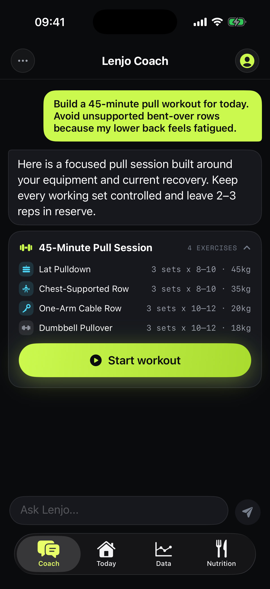
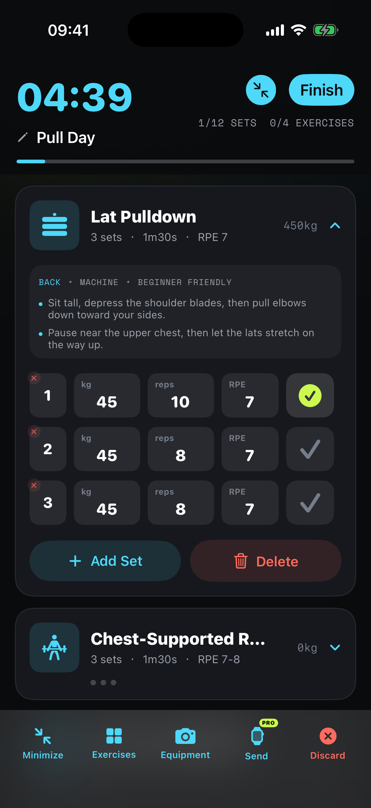
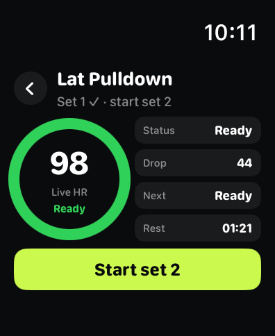

# Lenjo / 练境 — AI Fitness Coach

**Lenjo (练境) is a local-first AI fitness coach and workout tracker for iPhone, with optional Apple Watch support.** It connects workout planning, actual sets, recovery context and nutrition records so you can review what to do next.

**练境是一款本地优先的 AI 健身教练与训练记录 App，适用于 iPhone，可选配 Apple Watch。** 先审核计划，再逐组记录实际完成情况，让下一次训练接上这一次。

[Product page / 产品页](https://zhangkaiming2579-dev.github.io/lenjo-app/) · [中文产品页](https://zhangkaiming2579-dev.github.io/lenjo-app/zh/) · [中文介绍](README.zh-CN.md) · [App Store](https://apps.apple.com/app/id6784486285) · [Official website](https://lenjoapp.com/en/) · [中文官网](https://lenjoapp.com/)

## Product facts

| Field | Details |
| --- | --- |
| Product | Lenjo / 练境 |
| App Store ID | 6784486285 |
| Category | Fitness, strength training, workout tracking, nutrition logging |
| Devices | iPhone with iOS 17 or later; optional Apple Watch with watchOS 10 or later |
| Product support | Lenjo / 练境 |
| Access | Free iPhone workout execution and logging; optional Lenjo Pro subscription |
| Official website | https://lenjoapp.com/ and https://lenjoapp.com/en/ |
| Public support | https://lenjoapp.com/support.html |
| Contact | KmTech2026@outlook.com |

## What you can do

- **Plan strength training:** tell the AI coach your goals, experience, equipment and available time. It can use saved workout history and permitted recovery information to suggest a structured session. Review exercises, sets, reps, load and rest before training.
- **Track actual workouts:** start a planned session or free workout on iPhone. Record weights, reps, RPE and completed sets, then save the session. Review the actual results with the coach before adjusting the next workout.
- **Record cardio:** log timed cardio sessions, with fields for speed, incline and distance where relevant. Pro users can record available heart-rate, calorie and distance data with Apple Watch.
- **Use Apple Watch:** Pro users can send a plan to a paired Watch, log sets from the wrist and view live heart-rate recovery guidance when the required health permissions and data are available.
- **Record meals:** log food manually or analyze a meal photo. Review the estimated food items, calories, protein, carbohydrate and fat, edit the result and confirm before saving. Photo estimates are not a substitute for weighing food.
- **Follow progress and context:** review training, body-weight, activity and recovery trends. Inspect, edit or delete the long-term memories used by the coach, including goals, equipment and preferences.

## Product screens

  
  
  

Product screenshots use example training data from the public website. They illustrate the workflow; appearance may vary by app version and language. Recovery guidance is a fitness reference, not a medical measurement.

## Free and Pro

iPhone workout execution and logging are free, with an AI trial allowance. Lenjo Pro adds Apple Watch workout execution and recovery guidance, higher AI coach and photo-analysis allowances, and deeper reports. Monthly and yearly subscriptions are available. Current prices, eligibility and usage limits are shown in the app and App Store; this page does not quote a universal price.

## Data and AI

Core records are primarily stored on your device. Sign in with Apple and Apple Health permissions are optional. AI coaching and photo analysis need an internet connection; relevant information is sent through the Lenjo gateway to third-party model providers after the AI processing explanation and consent. You can decline AI processing and continue using local logging.

Lenjo provides fitness, training, recovery and nutrition references. It does not diagnose or treat medical conditions or guarantee training outcomes.

[Privacy policy](https://lenjoapp.com/privacy.html) · [Terms](https://lenjoapp.com/terms.html)

## Getting started and questions

[Getting started / 上手步骤](docs/getting-started.md) · [FAQ / 常见问题](docs/faq.md) · [Product facts JSON](product.json) · [Release notes](CHANGELOG.md)

## Support

For product questions, use the [support page](https://lenjoapp.com/support.html) or email [KmTech2026@outlook.com](mailto:KmTech2026@outlook.com). Public Issues are for general bugs and feature requests; keep personal health data, private conversations and diagnostic files out of public reports.

This is the developer's public product-information and support repository. The Lenjo application is proprietary; its source code is not distributed here. See [content rights](CONTENT-RIGHTS.md).

Product information checked on **2026-10-11** against the public App Store listing and official website. For current availability and released functionality, check the [App Store listing](https://apps.apple.com/app/id6784486285).
